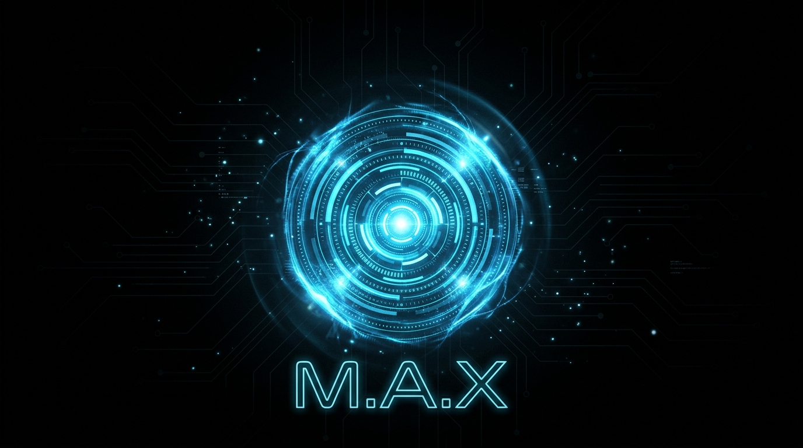

<p align="center">
  
</p>

<div align="center">

# ⚡ M · A · X

### 𝙈𝙤𝙙𝙪𝙡𝙖𝙧 𝘼𝙪𝙩𝙤𝙣𝙤𝙢𝙤𝙪𝙨 𝙚𝙓𝙚𝙘𝙪𝙩𝙤𝙧


<br/>

[](https://python.org)
[](https://ai.google.dev/)
[](https://openrouter.ai/)
[](#)

<br/>

[](https://github.com/Nishith45o7/MAX/stargazers)
[](https://github.com/Nishith45o7/MAX/network)
[](https://github.com/Nishith45o7/MAX/issues)
[](https://creativecommons.org/licenses/by-nc/4.0/)

<br/>


</div>

<br/>

<div align="center">
  
</div>

<br/>

> <picture>
>   <source media="(prefers-color-scheme: dark)" srcset="https://raw.githubusercontent.com/Mqxx/GitHub-Markdown/main/blockquotes/badge/dark-theme/info.svg">
>   
> </picture>
>
> **MAX** is an open-source, JARVIS-inspired desktop AI that transforms your computer into an intelligent, voice-controlled autonomous system. It doesn't just answer questions — it **sees your screen**, **hears your voice**, **remembers your context**, and **takes action** on your behalf.

<br/>


##  What Makes MAX Different

<table>
<tr>
<td>

```diff
+ ✅ Real-time native audio conversation
+ ✅ Sees & understands your screen live
+ ✅ Persistent memory across sessions
+ ✅ Full operating system control
+ ✅ Autonomous multi-step task execution
+ ✅ Zero monthly subscriptions
+ ✅ 100% local execution — your data stays yours
+ ✅ Cross-platform: Windows • macOS • Linux
```

</td>
<td>

```diff
- ❌ No cloud dependency for core features
- ❌ No telemetry or tracking
- ❌ No subscription required
- ❌ No data leaves your machine
- ❌ No vendor lock-in
- ❌ No bloatware
```

</td>
</tr>
</table>

<br/>


##  Features

<div align="center">
  
</div>

<br/>

<details>
<summary><h3>🎙️ Real-Time Voice Engine</h3></summary>

<br/>

> Powered by **Gemini Live Native Audio** — ultra-low latency, natural conversation in **any language**.

```
🗣️ "Hey Max, what's on my screen right now?"
🗣️ "Open Chrome and search for Python tutorials"  
🗣️ "İstanbul hava durumu?"  →  Responds in Turkish
🗣️ "Translate this document to Spanish"
```

**Tech:** `Gemini 2.5 Flash` · `Native Audio Preview` · `16kHz Send / 24kHz Receive` · `Real-time Streaming`

</details>

<details>
<summary><h3>👁️ Visual Intelligence</h3></summary>

<br/>

> Real-time **screen capture**, **webcam vision**, and **document analysis** powered by Gemini's multimodal capabilities.

| Capability | Description |
|:---:|:---|
| 🖥️ **Screen Vision** | Captures & analyzes your screen in real-time |
| 📸 **Webcam Feed** | Processes live camera input for visual context |
| 📄 **Document Upload** | Drop PDFs, code files, or images for instant analysis |
| 🔍 **OCR & Extraction** | Reads text from images and screenshots |

**Tech:** `OpenCV` · `MSS Screen Capture` · `PIL` · `Gemini Vision API`

</details>

<details>
<summary><h3>🧠 Persistent Memory System</h3></summary>

<br/>

> MAX **remembers you** — your identity, preferences, projects, relationships, and notes across every session.

```
Memory Architecture
├── 🪪 Identity        →  Name, occupation, preferences
├── ⚙️ Preferences     →  UI settings, response style  
├── 📂 Projects        →  Active work, deadlines, context
├── 👥 Relationships   →  People you mention, their roles
├── 💫 Wishes          →  Goals and aspirations
└── 📝 Notes           →  Anything MAX finds important
```

**Tech:** `SQLite` · `JSON Long-Term Store` · `Semantic Context Retrieval` · `Auto-Extraction`

</details>

<details>
<summary><h3>🖥️ Full OS Control</h3></summary>

<br/>

> Complete operating system automation through natural language.

| Command | What MAX Does |
|:---|:---|
| *"Set volume to 50%"* | Adjusts system volume |
| *"Maximize this window"* | Controls window state |
| *"Take a screenshot"* | Captures & saves screen |
| *"Open VS Code"* | Launches applications |
| *"Lock my computer"* | System security actions |
| *"Turn up brightness"* | Display controls |
| *"Restart the system"* | Power management |
| *"Close this tab"* | Browser/app control |

**Tech:** `PyAutoGUI` · `psutil` · `pycaw (Windows)` · `subprocess` · `Platform-Adaptive`

</details>

<details>
<summary><h3>🌐 Web & Browser Automation</h3></summary>

<br/>

> Intelligent web search and full browser automation via Playwright.

```
🔍 Web Search      →  DuckDuckGo powered, privacy-first
🌐 Browser Control →  Navigate, click, fill forms, extract data  
📊 Comparison      →  Side-by-side product/service comparison
📰 Research        →  Multi-source information synthesis
```

**Tech:** `Playwright` · `DuckDuckGo Search` · `BeautifulSoup4` · `Cross-Browser Support`

</details>

<details>
<summary><h3>🎮 Gaming Integration</h3></summary>

<br/>

> Direct **Steam** & **Epic Games** management through voice or text.

```
🎮 "List all my Steam games"          →  Scans library
📥 "Install GTA V from Epic"          →  Triggers download  
🔄 "Update Counter-Strike"            →  Initiates update
📊 "Check download progress"          →  Reports status
📅 "Schedule updates for tonight"     →  Queues tasks
```

**Tech:** `Steam Registry Integration` · `Epic Games Launcher API` · `Background Task Queue`

</details>

<details>
<summary><h3>✈️ Smart Actions Suite</h3></summary>

<br/>

> A full toolkit of intelligent actions for daily productivity.

| Module | Capability |
|:---:|:---|
| ✈️ **Flight Finder** | Search & compare flights across airlines |
| 🌤️ **Weather** | Real-time weather reports for any city |
| ⏰ **Reminders** | Smart scheduling with natural language |
| 📄 **Doc Generator** | Create PDFs and PowerPoint presentations |
| 💬 **Messaging** | Send messages through integrated channels |
| 💻 **Code Helper** | Intelligent code analysis & generation |
| 🛠️ **Dev Agent** | Full development workflow automation |
| 🔌 **Public APIs** | Extensible API integration framework |

</details>

<details>
<summary><h3>🤖 Autonomous Agent Engine</h3></summary>

<br/>

> Complex multi-step goals are **automatically decomposed** into tasks and executed sequentially.

```
User: "Research the top 5 AI frameworks and save a comparison to my desktop"

MAX Agent:
  Step 1 → 🔍 web_search("top AI frameworks 2025 comparison")
  Step 2 → 📊 Analyze and structure results  
  Step 3 → 📄 file_controller(create comparison document)
  Step 4 → 💾 Save to Desktop
  Step 5 → ✅ Report completion
```

**Tech:** `Planner-Executor Pattern` · `Error Self-Healing` · `Priority Task Queue` · `Max 5-Step Plans`

</details>

<br/>


##  Architecture

<div align="center">
  
</div>

```
╔═══════════════════════════════════════════════════════════════════════════╗
║                                                                           ║
║   ╭─────────── LAYER 1: INTERFACE ───────────╮                            ║
║   │                                          │                            ║
║   │   🎙️ Voice Engine      🖥️ PyQt6 HUD      │                            ║
║   │   (Gemini Live)        (Dark / Light)    │                            ║
║   │   ⌨️ Text Input        📂 Drag & Drop     │                            ║
║   │                                          │                            ║
║   ╰──────────────────┬───────────────────────╯                            ║
║                      │                                                    ║
║   ╭──────────── LAYER 2: BRAIN ──────────────╮                            ║
║   │                  ▼                       │                            ║
║   │   🧠 MAX Brain (Unified Function-Calling)│                            ║
║   │   ├── Tool Selection & Dispatch          │                            ║
║   │   ├── Context Assembly                   │                            ║
║   │   └── Response Generation                │                            ║
║   │                                          │                            ║
║   │   💾 Memory Engine                       │                            ║
║   │   ├── SQLite Conversations               │                            ║
║   │   ├── JSON Long-Term Memory              │                            ║
║   │   └── Semantic Context Retrieval         │                            ║
║   │                                          │                            ║
║   ╰──────────────────┬───────────────────────╯                            ║
║                      │                                                    ║
║   ╭──────────── LAYER 3: ACTIONS ────────────╮                            ║
║   │                  ▼                       │                            ║
║   │   🖥️ Desktop     🌐 Browser    📂 Files   │                            ║
║   │   🎮 Games       🔍 Search     👁️ Vision  │                            ║
║   │   💻 Code        ✈️ Flights    🌤️ Weather │                            ║
║   │   📄 Docs        ⏰ Reminders  💬 Msgs    │                            ║
║   │   🛠️ Dev Agent   🔧 Settings   📺 YouTube │                            ║
║   │                                          │                            ║
║   ╰──────────────────┬───────────────────────╯                            ║
║                      │                                                    ║
║   ╭──────────── LAYER 4: GATEWAY ────────────╮                            ║
║   │                  ▼                       │                            ║
║   │   🔀 OmniRoute (Free LLM Routing)       │                            ║
║   │   📱 Telegram Bot (Remote Control)       │                            ║
║   │   🔑 OpenRouter (Cost-Free Inference)    │                            ║
║   │                                          │                            ║
║   ╰──────────────────────────────────────────╯                            ║
║                                                                           ║
╚═══════════════════════════════════════════════════════════════════════════╝
```

<br/>


##  Project Structure

```
MAX/
│
├── 🧠 main.py                  # Voice engine — Gemini Live real-time audio
├── 🤖 max_brain.py             # Central brain — unified function-calling engine  
├── 🖥️ ui.py                    # PyQt6 HUD — adaptive dark/light interface
├── 🔧 or_client.py             # OpenRouter API client
├── 📄 doc_tools.py             # PDF & PowerPoint generation
├── 🌐 web_tool.py              # Web search utility
│
├── ⚡ actions/                  # ─── Modular Action Plugins ───
│   ├── browser_control.py       #     🌐 Playwright browser automation
│   ├── code_helper.py           #     💻 Code analysis & generation
│   ├── computer_control.py      #     🖥️ Terminal & system commands
│   ├── computer_settings.py     #     ⚙️ Volume, brightness, shortcuts
│   ├── desktop.py               #     🖱️ Desktop automation (clicks, typing)
│   ├── dev_agent.py             #     🛠️ Full development workflow agent
│   ├── file_controller.py       #     📂 File CRUD operations
│   ├── file_processor.py        #     📎 Document upload & analysis
│   ├── flight_finder.py         #     ✈️ Flight search & comparison
│   ├── game_updater.py          #     🎮 Steam & Epic Games management
│   ├── open_app.py              #     🚀 Cross-platform app launcher
│   ├── public_api_tools.py      #     🔌 Public API integrations
│   ├── reminder.py              #     ⏰ Smart reminders
│   ├── screen_processor.py      #     👁️ Real-time screen vision
│   ├── send_message.py          #     💬 Message dispatch
│   ├── weather_report.py        #     🌤️ Weather information
│   ├── web_search.py            #     🔍 DuckDuckGo search engine
│   └── youtube_video.py         #     📺 YouTube operations
│
├── 🤖 agent/                    # ─── Autonomous Task Engine ───
│   ├── planner.py               #     📋 Multi-step goal decomposition
│   ├── executor.py              #     ▶️ Sequential task execution
│   ├── task_queue.py            #     📊 Priority task queue
│   └── error_handler.py         #     🛡️ Self-healing error recovery
│
├── 🌐 gateway/                  # ─── External Communication ───
│   ├── omniroute_manager.py     #     🔀 OmniRoute LLM gateway
│   └── telegram_gateway.py      #     📱 Telegram bot remote control
│
├── 💾 memory/                   # ─── Persistent Intelligence ───
│   ├── memory_manager.py        #     🧠 Identity & preference memory
│   ├── db.py                    #     🗄️ SQLite conversation store
│   └── config_manager.py        #     ⚙️ Configuration persistence
│
├── ⚙️ core/                     # ─── Core System ───
│   └── prompt.txt               #     🎭 System personality & rules
│
├── 🔑 config/                   # ─── Configuration ───
│   └── api_keys.example.json    #     📝 API key template
│
├── 🎨 assets/                   # ─── Media Assets ───
│   └── max_banner.jpg           #     🖼️ README banner
│
├── 📦 requirements.txt          # Python dependencies
├── 🚀 setup.py                  # One-click installer
├── ▶️ run_max.bat               # Windows launcher
└── 🔀 start_omniroute.bat       # OmniRoute server launcher
```

<br/>


##  Quick Start

<div align="center">
  
</div>

<br/>

### 📋 Prerequisites

<div align="center">

| Requirement | Details | Status |
|:---:|:---|:---:|
| **🖥️ OS** | Windows 10/11 • macOS • Linux |  |
| **🐍 Python** | 3.11 or 3.12 |  |
| **🎙️ Microphone** | Any USB/built-in mic |  |
| **🔑 Gemini Key** | [Get Free Key →](https://aistudio.google.com/apikey) |  |
| **🔑 OpenRouter Key** | [Get Free Key →](https://openrouter.ai/keys) |  |

</div>

### 🚀 Installation

```bash
# ── Step 1: Clone the repository ──
git clone https://github.com/Nishith45o7/MAX.git
cd MAX

# ── Step 2: Install dependencies ──
pip install -r requirements.txt

# ── Step 3: Install Playwright browsers ──
playwright install

# ── Step 4: Configure API keys ──
cp config/api_keys.example.json config/api_keys.json
# Edit config/api_keys.json and add your Gemini + OpenRouter API keys

# ── Step 5: Launch MAX ──
python main.py
```

> [!NOTE]
> **🪟 Windows users** — Double-click `run_max.bat` to launch MAX after setup.

> [!TIP]
> If you get a `ModuleNotFoundError`, install the missing package: `pip install <module_name>`

<br/>


## 🔑 Configuration

Create your config file from the template:

```json
{
    "gemini_api_key": "YOUR_GEMINI_API_KEY_HERE",
    "openrouter_api_key": "YOUR_OPENROUTER_API_KEY_HERE",
    "os_system": "windows",
    "use_omniroute": true,
    "omniroute_base_url": "http://localhost:20128/v1",
    "omniroute_api_key": "omniroute",
    "omniroute_model": "auto"
}
```

<div align="center">

| Key | Source | Cost |
|:---|:---:|:---:|
| `gemini_api_key` | [Google AI Studio](https://aistudio.google.com/apikey) |  |
| `openrouter_api_key` | [OpenRouter](https://openrouter.ai/keys) |  |

</div>

<br/>


##  OmniRoute — Smart LLM Routing

<div align="center">
  
</div>

<br/>

```
   ┌────────────────────────────────────────────────────────┐
   │                                                        │
   │   🎙️ Gemini Live ──────▶  Real-time Voice              │
   │   (Native Audio)         + Tool Calling                │
   │                          + Screen Vision               │
   │                                                        │
   │   ─ ─ ─ ─ ─ ─ ─ ─ ─ ─ ─ ─ ─ ─ ─ ─ ─ ─ ─ ─ ─ ─ ─   │
   │                                                        │
   │   🔀 OpenRouter ───────▶  Web Search                   │
   │   (Free Tier)             Memory Queries               │
   │                           Desktop Control              │
   │                           Code Generation              │
   │                           Document Creation            │
   │                                                        │
   └────────────────────────────────────────────────────────┘
                          │
                          ▼
              ⚡ 40% Faster Interaction
              💰 $0/month Running Cost
              ♾️  Virtually Unlimited Requests
```

<br/>


## 📱 Telegram Remote Control

> Control MAX from anywhere using your phone.

```
1. 🤖 Create a bot via @BotFather on Telegram  
2. 🔑 Add the token to your config
3. 👤 Whitelist your Telegram user ID
4. ▶️ Run start_omniroute.bat  
5. 💬 Use /start to begin
```

> [!IMPORTANT]
> Only whitelisted user IDs can interact with your MAX instance — your system stays secure.

<br/>


## 🛡️ Security & Privacy

<div align="center">

| Protection | Status |
|:---|:---:|
| 🔐 API keys stored locally (git-ignored) | ✅ |
| 🚫 No data sent to third-party servers | ✅ |
| 🏠 100% local execution | ✅ |
| 🔒 Telegram user whitelisting | ✅ |
| 🛡️ No telemetry or tracking | ✅ |
| 📦 Open-source & auditable | ✅ |

</div>

<br/>


##  Contributing

Contributions, issues, and feature requests are welcome!

```
1. 🍴 Fork the repository
2. 🌿 Create a branch    →  git checkout -b feature/awesome
3. 💾 Commit changes     →  git commit -m 'Add awesome feature'
4. 🚀 Push to branch     →  git push origin feature/awesome
5. 📬 Open a Pull Request
```

<br/>


## ⚖️ License

<div align="center">

This project is licensed under **[Creative Commons BY-NC 4.0](https://creativecommons.org/licenses/by-nc/4.0/)**

*Personal and non-commercial use only.*

</div>

<br/>


<br/>

<div align="center">


<br/><br/>

[](https://github.com/Nishith45o7)

<br/>

<sub>Engineered with ❤️ — building a real-world autonomous AI, one commit at a time.</sub>

<br/><br/>


</div>
